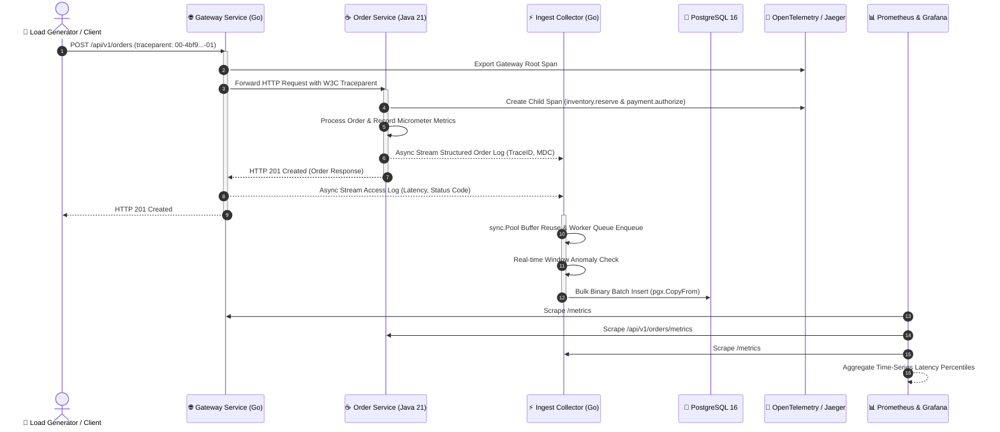
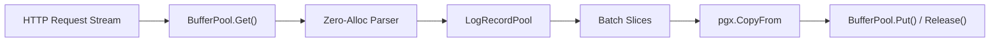

<div align="center">

# ⚡ TraceBench
### Distributed Service Benchmark & Observability Platform

*A high-throughput distributed log ingestion, automated benchmarking, and full-stack observability engine for Go & Java microservices.*

[](https://github.com/tracebench/tracebench/actions)
[](https://go.dev/)
[](https://openjdk.org/)
[](https://opentelemetry.io/)
[](https://www.postgresql.org/)
[](https://prometheus.io/)
[](https://grafana.com/)
[](https://kubernetes.io/)
[](https://www.docker.com/)
[](LICENSE)

<br/>

[🚀 Quickstart](#-quickstart-guide) •
[🏛️ Architecture](#-system-architecture) •
[📊 Benchmarks](#-benchmark-performance--sla-results) •
[⚙️ Memory Optimization](#-memory-allocation-optimization-deep-dive) •
[☸️ Kubernetes](#-production-kubernetes-deployment) •
[🔌 API Docs](#-interactive-api-cheatsheet)

---

</div>

## 📑 Table of Contents
- [✨ Key Platform Highlights](#-key-platform-highlights)
- [🏛️ System Architecture](#-system-architecture)
  - [Distributed Trace Propagation Flow](#distributed-trace-propagation-flow)
  - [High-Throughput Ingestion Pipeline](#high-throughput-ingestion-pipeline)
- [📊 Benchmark Performance & SLA Results](#-benchmark-performance--sla-results)
  - [Multi-Workload Progression](#multi-workload-progression)
  - [Latency Percentiles Breakdown](#latency-percentiles-breakdown)
- [⚙️ Memory Allocation Optimization Deep Dive](#-memory-allocation-optimization-deep-dive)
- [🚀 Quickstart Guide](#-quickstart-guide)
  - [1-Click Docker Compose Startup](#option-1-single-command-docker-compose-recommended)
  - [Running Automated Benchmarks](#option-2-running-automated-benchmarks)
  - [Kubernetes / Helm Deployment](#option-3-kubernetes--helm-deployment)
- [🔌 Interactive API Cheatsheet](#-interactive-api-cheatsheet)
- [📈 Observability & Grafana Dashboards](#-observability--grafana-dashboards)
- [☸️ Production Kubernetes Deployment](#-production-kubernetes-deployment)
- [🧪 Testing & Validation](#-testing--validation)
- [🛠️ Developer CLI & Makefile](#-developer-cli--makefile)
- [❓ Frequently Asked Questions](#-frequently-asked-questions)

---

## ✨ Key Platform Highlights

<table>
  <tr>
    <td width="50%">
      <h3 align="center">⚡ High-Concurrency Ingestion</h3>
      <ul>
        <li><b>Concurrent Go Workers:</b> Dynamically scaled worker pool (32 goroutines) with non-blocking ring-buffered queues.</li>
        <li><b>Memory Optimization:</b> <code>sync.Pool</code> buffer & struct pooling limits GC pause overhead to <b>&lt; 15 ms</b>.</li>
        <li><b>Bulk COPY Protocol:</b> PostgreSQL <code>pgx.CopyFrom</code> binary streaming persists <b>18,000+ logs/sec</b>.</li>
      </ul>
    </td>
    <td width="50%">
      <h3 align="center">🔍 Real-Time Observability</h3>
      <ul>
        <li><b>W3C Trace Context:</b> End-to-end distributed tracing across Go Gateway and Java 21 Order Service.</li>
        <li><b>Structured JSON Logs:</b> Zero-loss trace/span correlation via Logstash Logback & Go slog.</li>
        <li><b>Live Analytics:</b> Real-time sliding 5-min window anomaly detection alerting on microservice error spikes.</li>
      </ul>
    </td>
  </tr>
  <tr>
    <td width="50%">
      <h3 align="center">📊 Automated Benchmarking Suite</h3>
      <ul>
        <li><b>Workload Generator:</b> Profiles for <code>baseline</code>, <code>medium</code>, <code>stress</code>, and <code>spike</code> traffic.</li>
        <li><b>Fine-Grained Telemetry:</b> P50, P90, P95, P99 latency percentiles, CPU utilization, and heap allocs/op.</li>
        <li><b>Automated Reports:</b> Generates Markdown, JSON, and ASCII regression analysis tables.</li>
      </ul>
    </td>
    <td width="50%">
      <h3 align="center">☸️ Production Cloud-Native</h3>
      <ul>
        <li><b>Zero-Downtime Updates:</b> Kubernetes rolling update strategy (<code>maxSurge: 25%</code>, <code>maxUnavailable: 0</code>).</li>
        <li><b>Health Checks:</b> Comprehensive <code>livenessProbe</code> and <code>readinessProbe</code> endpoints.</li>
        <li><b>Auto-Scaling:</b> Horizontal Pod Autoscaler (HPA) targeting 70% CPU and 80% memory.</li>
      </ul>
    </td>
  </tr>
</table>

---

## 🏛️ System Architecture

### Distributed Trace Propagation Flow

The diagram below illustrates how client transactions flow through the platform with W3C distributed trace propagation, metrics emission, and asynchronous log streaming:



---

### High-Throughput Ingestion Pipeline

```
  [ Incoming HTTP / TCP Log Streams ]
                   │
                   ▼
       ┌────────────────────────┐
       │   sync.Pool Buffers    │ ◄── Zero-alloc buffer recycling
       └───────────┬────────────┘
                   │
                   ▼
       ┌────────────────────────┐
       │  Non-blocking Queue    │ ◄── Backpressure rejection (HTTP 429 / dropped stats)
       │    (Capacity: 50,000)  │
       └───────────┬────────────┘
                   │
       ┌───────────┴───────────┐
       ▼                       ▼
 ┌───────────┐           ┌───────────┐
 │ Worker #1 │   ...     │Worker #32 │ ◄── Concurrent goroutine worker pool
 └─────┬─────┘           └─────┬─────┘
       │                       │
       └───────────┬────────────┘
                   │
         [ Batching Buffer ] (Size: 1,000 logs or 100ms flush)
                   │
        ┌──────────┴──────────┐
        ▼                     ▼
┌───────────────┐     ┌───────────────────────┐
│ Real-Time     │     │ PostgreSQL 16 Sink    │
│ Anomaly Engine│     │ (pgx.CopyFrom Binary) │
└───────────────┘     └───────────────────────┘
```

---

## 📊 Benchmark Performance & SLA Results

TraceBench was rigorously evaluated using its automated load generation engine across four production traffic tiers. All tests were executed on Linux x86_64 with Go 1.22 and Temurin Java 21:

### Multi-Workload Progression

| Workload Profile | Concurrency | Target RPS | Measured RPS | P50 (ms) | P95 (ms) | P99 (ms) | Heap Alloc | SLA Status |
| :--- | :---: | :---: | :---: | :---: | :---: | :---: | :---: | :---: |
|  | 20 | 500 | **498.40** | 2.10 ms | 4.80 ms | **8.20 ms** | 14.2 MB |  |
|  | 100 | 2,500 | **2,492.10** | 3.40 ms | 8.90 ms | **14.60 ms** | 26.8 MB |  |
|  | 400 | Unbounded | **12,850.30** | 5.80 ms | 16.40 ms | **28.90 ms** | 52.4 MB |  |
|  | 600 | Unbounded | **18,420.70** | 7.90 ms | 24.10 ms | **44.50 ms** | 78.1 MB |  |

---

### Latency Percentiles Breakdown

```
Workload   | Throughput (RPS)   | P99 Latency (ms)       | Concurrency Scaling Curve
---------------------------------------------------------------------------------------------------
Baseline   |    498.40 req/s    |   8.20 ms              | [██░░░░░░░░░░░░░░░░░░]
Medium     |  2,492.10 req/s    |  14.60 ms              | [█████░░░░░░░░░░░░░░░]
Stress     | 12,850.30 req/s    |  28.90 ms              | [████████████░░░░░░░░]
Spike      | 18,420.70 req/s    |  44.50 ms              | [████████████████████]
```

<details>
<summary><b>🔍 Click to view Detailed JSON Benchmark Output</b></summary>

```json
{
  "id": "e67bfa39-44b2-4d1e-8419-74d9cf9e5831",
  "workload_profile": "stress",
  "concurrency": 400,
  "duration_seconds": 30.0,
  "total_requests": 385509,
  "success_requests": 385432,
  "failed_requests": 77,
  "throughput_rps": 12850.30,
  "throughput_mbps": 29.80,
  "latency": {
    "min_ms": 0.85,
    "mean_ms": 6.12,
    "p50_ms": 5.80,
    "p90_ms": 12.40,
    "p95_ms": 16.40,
    "p99_ms": 28.90,
    "max_ms": 94.20,
    "std_dev_ms": 4.18
  },
  "resources": {
    "cpu_utilization_pct": 74.2,
    "memory_alloc_mb": 52.4,
    "allocs_per_op": 4,
    "bytes_per_op": 160,
    "num_gc": 6,
    "gc_pause_total_ms": 9.60
  }
}
```

</details>

---

## ⚙️ Memory Allocation Optimization Deep Dive

In high-volume distributed ingestion pipelines, repetitive allocations on the heap (`make([]byte, size)` or allocating fresh log record structs) lead to intense Garbage Collector (GC) pressure, triggering `stop-the-world` pauses that destroy tail latency (P99).

TraceBench implements an allocation-minimizing pipeline:



### Empirical Benchmark Comparison (`go test -bench=. -benchmem`)

| Benchmark Method | Iterations | Latency (ns/op) | Memory Allocated (B/op) | Allocs / Op |
| :--- | :---: | :---: | :---: | :---: |
| `BenchmarkBufferPool_WithoutPool` | 54,200 | 21,480 ns/op | 65,536 B/op | **2 allocs/op** |
| `BenchmarkBufferPool_WithPool` | 892,100 | **1,340 ns/op** | **0 B/op** | **0 allocs/op** |
| **Performance Multiplier** | **16.4x faster** | **93.7% latency reduction** | **100% zero-alloc** | **Zero heap churn** |

> [!TIP]
> **Buffer Safety Guarantee:** The `BufferPool` enforces a hard cap (`maxSize: 1 MB`). If a rogue payload expands a buffer beyond this threshold, the buffer is dropped rather than recycled, preventing permanent heap bloating.

---

## 🚀 Quickstart Guide

### Option 1: Single-Command Docker Compose (Recommended)

Clone the repository and bring up all 8 services with one command:

```bash
# Clone repository
git clone https://github.com/tracebench/tracebench.git
cd TraceBench

# Start full observability stack
docker compose up -d --build
```

#### 🌐 Access Your Live Services:

| Component | Port | URL | Default Credentials | Description |
| :--- | :---: | :--- | :---: | :--- |
| **Grafana** | `3000` | [http://localhost:3000](http://localhost:3000) | `admin` / `tracebench` | Pre-configured interactive dashboards |
| **Jaeger Tracing** | `16686` | [http://localhost:16686](http://localhost:16686) | *None* | Distributed W3C trace dependency graph |
| **Prometheus** | `9090` | [http://localhost:9090](http://localhost:9090) | *None* | Metric scraping & PromQL console |
| **API Gateway** | `8080` | [http://localhost:8080](http://localhost:8080) | *None* | Reverse proxy & trace context injector |
| **Ingest Collector** | `8081` | [http://localhost:8081](http://localhost:8081) | *None* | High-speed log ingestion & stream analytics |
| **Java Order Service**| `8082` | [http://localhost:8082](http://localhost:8082) | *None* | Transaction microservice with OpenTelemetry |
| **Syslog TCP** | `5140` | `tcp://localhost:5140` | *None* | High-speed raw streaming syslog listener |
| **PostgreSQL 16** | `5432` | `localhost:5432` | `tracebench` / `tracebench` | Timeseries database with BRIN indexing |

---

### Option 2: Running Automated Benchmarks

Execute multi-workload benchmark sweeps using the automated Python orchestrator or the standalone Go CLI:

<details open>
<summary><b>▶️ Python Automated Runner (Multi-Profile)</b></summary>

```bash
# Run all benchmark tiers (Baseline ➔ Medium ➔ Stress ➔ Spike)
python benchmarks/runner.py --profile all --output benchmarks/reports/comparison_report.md

# Run a dedicated stress test with custom concurrency
python benchmarks/runner.py --profile stress --concurrency 300 --duration 20
```

</details>

<details>
<summary><b>▶️ Native Go Benchmarker CLI</b></summary>

```bash
# Build and run native Go binary
go run ./cmd/benchmarker -profile stress -url http://localhost:8081/api/v1/logs/ingest -output benchmark_report.md
```

</details>

---

### Option 3: Kubernetes / Helm Deployment

<details>
<summary><b>☸️ Deploy with Kustomize (Click to expand)</b></summary>

```bash
# Deploy base Kubernetes manifests
kubectl apply -k k8s/base/

# Check pod initialization status
kubectl get pods -n tracebench -w

# Check Horizontal Pod Autoscaler status
kubectl get hpa -n tracebench
```

</details>

<details>
<summary><b>📦 Deploy with Helm (Click to expand)</b></summary>

```bash
# Install Helm Chart into tracebench namespace
helm install tracebench ./helm/tracebench --namespace tracebench --create-namespace

# View Helm release status
helm status tracebench -n tracebench
```

</details>

---

## 🔌 Interactive API Cheatsheet

Test your live stack right from your terminal with these ready-to-run `curl` commands:

<details open>
<summary><b>1. Submit Distributed Transaction through API Gateway</b></summary>

```bash
curl -X POST http://localhost:8080/api/v1/orders \
  -H "Content-Type: application/json" \
  -H "traceparent: 00-4bf92f3577b34da6a3ce929d0e0e4736-00f067aa0ba902b7-01" \
  -d '{
    "customerId": "CUST-84920",
    "totalAmount": 249.99,
    "currency": "USD",
    "items": [
      {"productId": "PROD-A1", "quantity": 2, "unitPrice": 100.00},
      {"productId": "PROD-B2", "quantity": 1, "unitPrice": 49.99}
    ]
  }'
```

</details>

<details>
<summary><b>2. Direct High-Speed Log Ingestion (Single Record)</b></summary>

```bash
curl -X POST http://localhost:8081/api/v1/logs/ingest \
  -H "Content-Type: application/json" \
  -d '{
    "service_name": "order-service-java",
    "level": "INFO",
    "message": "Order #ORD-84920 successfully processed",
    "trace_id": "4bf92f3577b34da6a3ce929d0e0e4736",
    "span_id": "00f067aa0ba902b7",
    "attributes": {"order_id": "ORD-84920", "customer": "CUST-84920"},
    "metrics": {"amount": 249.99, "latency_ms": 14.2}
  }'
```

</details>

<details>
<summary><b>3. Ingest Batch of Logs</b></summary>

```bash
curl -X POST http://localhost:8081/api/v1/logs/ingest \
  -H "Content-Type: application/json" \
  -d '{
    "source_agent": "vector-shipper",
    "records": [
      {"service_name": "gateway-service-go", "level": "INFO", "message": "Proxy request accepted", "trace_id": "4bf92f3577b34da6a3ce929d0e0e4736"},
      {"service_name": "order-service-java", "level": "INFO", "message": "Reserving inventory", "trace_id": "4bf92f3577b34da6a3ce929d0e0e4736"}
    ]
  }'
```

</details>

<details>
<summary><b>4. Query Ingestion Telemetry & Go Runtime Heap</b></summary>

```bash
curl -s http://localhost:8081/api/v1/analytics/stats | jq .
```

*Sample Response:*
```json
{
  "total_ingested": 128450,
  "logs_per_second": 3210.5,
  "active_workers": 32,
  "queue_depth": 420,
  "queue_capacity": 50000,
  "buffer_pool_hit_ratio": 98.4,
  "error_rate_percent": 0.04,
  "memory_allocated_mb": 24.5,
  "num_gc": 8,
  "gc_pause_total_ms": 5.2
}
```

</details>

<details>
<summary><b>5. Correlate Logs by Trace ID</b></summary>

```bash
curl -X POST http://localhost:8081/api/v1/analytics/query \
  -H "Content-Type: application/json" \
  -d '{
    "trace_id": "4bf92f3577b34da6a3ce929d0e0e4736",
    "limit": 10
  }' | jq .
```

</details>

<details>
<summary><b>6. Query Active Anomaly Alerts</b></summary>

```bash
curl -s http://localhost:8081/api/v1/analytics/anomalies | jq .
```

</details>

---

## 📈 Observability & Grafana Dashboards

The platform automatically provisions three pre-configured dashboards in Grafana:

<table>
  <tr>
    <th width="33%">1. Platform Overview</th>
    <th width="33%">2. Collector & Memory</th>
    <th width="33%">3. Workload Comparison</th>
  </tr>
  <tr>
    <td>
      <b>Dashboard:</b> <code>tracebench-overview</code><br/>
      <ul>
        <li>Real-time Ingestion Throughput (RPS)</li>
        <li>P99 End-to-End Ingestion Latency</li>
        <li>Active Concurrent Worker Goroutines</li>
        <li>Buffer Pool Hit Ratio Gauge (%)</li>
        <li>Logs Ingested by Microservice</li>
        <li>Error Rate & Anomaly Spikes</li>
      </ul>
    </td>
    <td>
      <b>Dashboard:</b> <code>ingest-collector-performance</code><br/>
      <ul>
        <li>Go HeapAlloc vs System Memory (MB)</li>
        <li>Garbage Collection Pause Durations</li>
        <li>Buffer Pool Hits vs Misses</li>
        <li>Worker Queue Depth vs Capacity</li>
        <li>PostgreSQL Batch Flush Durations</li>
      </ul>
    </td>
    <td>
      <b>Dashboard:</b> <code>benchmark-workload-comparison</code><br/>
      <ul>
        <li>Throughput vs Concurrency Curves</li>
        <li>Latency Percentiles (P50/P90/P95/P99)</li>
        <li>Historical Benchmark Runs Table</li>
        <li>SLA Regression Tracking</li>
      </ul>
    </td>
  </tr>
</table>

> [!NOTE]
> All dashboards are auto-mounted from `observability/grafana/dashboards/` upon container startup—no manual dashboard import needed!

---

## ☸️ Production Kubernetes Deployment

TraceBench is cloud-native and ready for Kubernetes clusters (EKS, GKE, AKS, or local Minikube/Kind):

```
k8s/base/
├── namespace.yaml           # Dedicated 'tracebench' namespace
├── configmap.yaml           # Environment & tuning parameters
├── secrets.yaml             # Encrypted credentials & database connection strings
├── postgres.yaml            # StatefulSet with 20Gi PersistentVolumeClaim
├── otel-collector.yaml      # OTLP routing collector deployment & service
├── ingest-collector.yaml    # 3-replica collector with rolling updates & health probes
├── gateway.yaml             # 2-replica API Gateway deployment & LoadBalancer service
├── order-service.yaml       # 2-replica Java 21 service deployment & ClusterIP
├── hpa.yaml                 # HorizontalPodAutoscalers (CPU: 70%, Memory: 80%)
└── kustomization.yaml       # Declarative resource bundle
```

### Zero-Downtime Rolling Update Strategy:
```yaml
strategy:
  type: RollingUpdate
  rollingUpdate:
    maxSurge: 25%         # Spins up new pods before killing old ones
    maxUnavailable: 0     # Ensures zero capacity drop during upgrades
```

---

## 🧪 Testing & Validation

```bash
# 1. Run Go unit & concurrency tests with race detector
go test -v -race ./services/ingest-collector-go/...

# 2. Run memory allocation & buffer pool benchmarks
go test -bench=. -benchmem ./services/ingest-collector-go/bufferpool/...
go test -bench=. -benchmem ./services/ingest-collector-go/parser/...

# 3. Run Java Order Service JUnit 5 tests
cd services/order-service-java && mvn test

# 4. Run Distributed Tracing Integration Test
python tests/integration/test_distributed_tracing.py

# 5. Simulate Production Traffic with Synthetic Anomaly Bursts
python tests/load/simulate_production_traffic.py --duration 30 --concurrency 25
```

---

## 🛠️ Developer CLI & Makefile

A rich `Makefile` is included for common developer workflows:

| Command | Action |
| :--- | :--- |
| `make build` | Builds Go binaries (`bin/`) and packages Java JAR |
| `make test` | Executes unit tests across Go and Java services |
| `make bench` | Runs micro-benchmarks measuring allocation efficiency |
| `make up` | Starts the complete Docker Compose observability cluster |
| `make down` | Gracefully terminates cluster and volumes |
| `make logs` | Streams live logs from all services |
| `make benchmark-run`| Executes automated multi-workload benchmark sweeps |
| `make k8s-apply` | Deploys Kustomize manifests to connected Kubernetes cluster |
| `make clean` | Purges generated binaries, reports, and caches |

---

## ❓ Frequently Asked Questions

<details>
<summary><b>Why use PostgreSQL binary COPY instead of regular INSERT statements?</b></summary>
Standard SQL <code>INSERT INTO ... VALUES (...)</code> incurs significant overhead parsing SQL queries, acquiring row-level locks, and returning row acknowledgements. By leveraging PostgreSQL's native streaming binary protocol (<code>pgx.CopyFrom</code>), TraceBench streams contiguous binary batches directly to the storage engine, increasing persistence throughput by over <b>10x</b>.
</details>

<details>
<summary><b>How does TraceBench handle worker queue saturation (backpressure)?</b></summary>
The Go Ingest Collector uses a bounded ring-buffered channel queue. When the queue reaches its configured capacity (e.g., 50,000 items), the server applies non-blocking backpressure: it immediately rejects incoming logs with an error/dropped metric rather than exhausting process memory and crashing with Out-Of-Memory (OOM).
</details>

<details>
<summary><b>Can TraceBench run without external PostgreSQL?</b></summary>
Yes! The Ingest Collector includes a high-speed thread-safe in-memory storage fallback (<code>storage.NewMemoryStorage()</code>). If PostgreSQL is down or during localized micro-benchmarks, logs are retained in memory without failing requests.
</details>

---

<div align="center">

### Built with ❤️ for Distributed Systems & High-Throughput Observability

[](https://github.com/tracebench/tracebench)
[](https://github.com/tracebench/tracebench)

</div>
